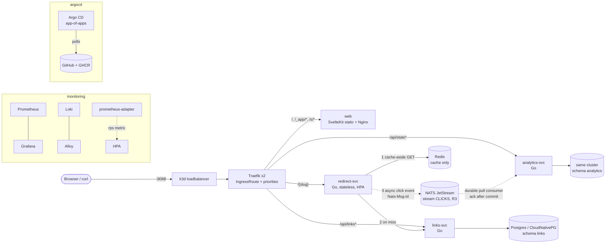

# Shorty

A minimalist URL shortener with click analytics. It is built as a reference
project for **high availability, performance tuning and GitOps** on a laptop
k3d cluster, with the same patterns you'd use in production.

- Paste a long URL, get a short link (optionally with a custom slug).
- `GET /{slug}` answers with a **302** in about 1 ms and records the click
  **asynchronously**.
- Each link's stats show total clicks, the last 24 h (hourly), the last 7
  days (daily) and the top referrers.

[](https://github.com/prasadgujar22/shorty/actions/workflows/links-svc.yml)
[](https://github.com/prasadgujar22/shorty/actions/workflows/redirect-svc.yml)
[](https://github.com/prasadgujar22/shorty/actions/workflows/analytics-svc.yml)
[](https://github.com/prasadgujar22/shorty/actions/workflows/web.yml)
[](https://github.com/prasadgujar22/shorty/actions/workflows/security.yml)

## Architecture



| Service | Language | Responsibility | State |
|---|---|---|---|
| `web` | SvelteKit (static) + Nginx | The only UI: shorten, recent links, link stats (pure-SVG charts) | none |
| `links-svc` | Go | `POST/GET /api/links`, `GET /api/links/{slug}`. System of record. | Postgres schema `links` |
| `redirect-svc` | Go | `GET /{slug}` → 302. Redis cache-aside, falls back to links-svc, publishes click events. | none (in-memory buffer) |
| `analytics-svc` | Go | JetStream consumer, idempotent aggregation, `GET /api/stats/{slug}` | Postgres schema `analytics` |

Every service has `/healthz` (liveness), `/readyz` (readiness) and
`/metrics` (Prometheus) on a separate **admin port :9090**, structured JSON
logs, graceful SIGTERM handling, 12-factor env config, and a multi-stage
**distroless/non-root** image built for `linux/arm64` and `linux/amd64`.

## Quickstart

Requirements: macOS or Linux, Docker with **≥ 10 GiB** memory (12 GiB
recommended), Homebrew (tools are installed for you).

```bash
make bootstrap && make up
```

- `make bootstrap` checks and installs the CLIs, creates the k3d cluster (1
  server + 3 agents in three zones, plus a local registry), and installs the
  platform: Traefik, CloudNativePG, Prometheus/Grafana, Loki/Alloy and
  prometheus-adapter.
- `make up` builds the four images, deploys the umbrella chart with your local
  images to namespace `shorty`, and runs an end-to-end smoke test.

Then open **http://localhost:8088**.

Day to day, pause and resume everything (cluster, platform, Argo CD and all
three envs) without losing data:

```bash
scripts/shortyctl.sh stop      # or: make stop    (~5 s; frees CPU, RAM, ports)
scripts/shortyctl.sh start     # or: make start   (~5-7 min; waits for health, smoke-tests all envs)
scripts/shortyctl.sh status    # or: make status
scripts/shortyctl.sh destroy   # delete everything (asks first)
```

`start` builds everything from scratch (bootstrap, local env, GitOps) when no
cluster exists.

Optional: hand the cluster to GitOps (Argo CD pulls this repo and GHCR):

```bash
make gitops        # dev auto-syncs from main at dev.localhost:8088; ha is manual at ha.localhost:8088
```

| URL | What |
|---|---|
| http://localhost:8088 | Shorty (local `make up` env) |
| http://dev.localhost:8088 / http://ha.localhost:8088 | Argo CD-managed `dev` / `ha` envs |
| http://grafana.localhost:8088 | Grafana: folder **Shorty** (overview + one RED dashboard per service). Anonymous view. |
| http://prometheus.localhost:8088 | Prometheus |
| http://argocd.localhost:8088 | Argo CD (`admin`, password printed by `make gitops`) |

`*.localhost` resolves to 127.0.0.1 in browsers and curl. Port 8088 is used
because 8080 is commonly taken (see [ADR 0007](docs/adr/0007-routing-and-reserved-slugs.md)).

### API

```bash
curl -s -XPOST localhost:8088/api/links -d '{"url":"https://go.dev/doc/effective_go","slug":"go-doc"}'
curl -sI localhost:8088/go-doc                  # 302 Location: https://go.dev/doc/effective_go
curl -s localhost:8088/api/stats/go-doc | jq    # total, hourly[24], daily[7], referrers
curl -s 'localhost:8088/api/links?limit=20'     # recent links (keyset pagination via ?before=)
```

## Make targets

| Target | What it does |
|---|---|
| `make help` | List all targets |
| `make bootstrap` | `tools` + `cluster-up` + `platform` |
| `make tools` | Verify/install CLIs (k3d, kubectl, helm, go, node, k6, golangci-lint, kubeconform, trivy, gitleaks, argocd, yq, jq) |
| `make cluster-up` / `cluster-down` | Create/delete the k3d cluster (1 server + 3 agents, zones a/b/c) and the registry at `127.0.0.1:5001` |
| `make platform` | Install Traefik, CloudNativePG and the observability stack (skips anything Argo CD already manages) |
| `make build` / `make build-<svc>` | Build images for the host arch and push to the local registry |
| `make test` | Go unit tests (race + coverage) and web unit tests |
| `make test-integration` | Go integration tests against throwaway Postgres/Redis/NATS containers |
| `make lint` | golangci-lint, eslint, svelte-check, helm lint, kubeconform |
| `make up` | `build` + `deploy` + `smoke` (`ENV=dev\|ha`) |
| `make deploy` | Helm upgrade the umbrella chart with local images into `NAMESPACE` (default `shorty`) |
| `make smoke` | End-to-end check through the gateway (`BASE_URL=...`) |
| `make start` / `make stop` | Resume / pause the whole setup, keeping data (`scripts/shortyctl.sh`) |
| `make status` | Cluster state, Argo CD apps, pod health and URLs |
| `make gitops` | Install Argo CD + app-of-apps |
| `make load` | k6 load test against the redirect path |
| `make chaos` / `make chaos-<scenario>` | Chaos scenarios under load, results appended to `docs/RESULTS.md` |
| `make dashboards` | Regenerate the Grafana dashboard JSON |
| `make clean` | Remove build output and delete the cluster |

## Repository layout

```
services/{web,links-svc,redirect-svc,analytics-svc}   # code + Dockerfile per service
pkg/                     # shared Go: config, logging, server lifecycle, httpx (RED), pg, events, slug, memlimit
deploy/
  k3d/cluster.yaml       # 1 server + 3 agents, zones, registry
  charts/                # shorty-lib (library), one chart per service, shorty (umbrella)
  envs/{dev,ha}/         # values.yaml (sizing) + images.yaml (tags written by CI)
  platform/              # pinned versions + values for Traefik, CNPG, monitoring, Loki, Alloy, adapter
  argocd/                # root app (app-of-apps) and child apps
  dashboards/            # generated Grafana dashboards + PrometheusRule (kustomize)
  compose/               # docker-compose for integration tests and a k8s-free dev stack
.github/workflows/       # per-service path-filtered CI, reusable workflows, security, release
chaos/  load/            # kubectl-only fault injection + k6
docs/                    # GITOPS, TUNING, RESULTS, ADRs
```

## CI/CD in one paragraph

A push touching `services/redirect-svc/**` (or `pkg/**`) runs only the
redirect-svc pipeline:
1. golangci-lint, unit tests with race detection and coverage, and
   integration tests against Postgres/Redis/NATS containers.
2. A multi-arch buildx image pushed to `ghcr.io/prasadgujar22/shorty-redirect-svc:<sha>`,
   with an SBOM, provenance, a build attestation, and a Trivy gate (fails on
   fixable HIGH/CRITICAL).
3. A commit of the new tag into `deploy/envs/dev/images.yaml`.

Argo CD in the laptop cluster notices within 60 s and rolls it out, with no
inbound access to the laptop. `git tag vX.Y.Z` builds semver images and pins
`deploy/envs/ha`, which a human then syncs. Details:
[docs/GITOPS.md](docs/GITOPS.md).

## HA and tuning

- Stateless services: ≥ 2 replicas in `ha`, topology spread across zones and
  nodes, PDBs, startup/readiness/liveness probes, `preStop` plus in-app drain
  for connection draining, and an HPA on redirect-svc (CPU + RPS).
- Clicks are never lost on graceful termination, NATS failover, Redis loss or
  Postgres failover. That is measured, not assumed:
  [docs/RESULTS.md](docs/RESULTS.md),
  [ADR 0008](docs/adr/0008-effectively-once-click-counting.md).
- Knobs explored with before/after numbers: [docs/TUNING.md](docs/TUNING.md).

## Docs

- [docs/GITOPS.md](docs/GITOPS.md): pull-based CD from behind a laptop
- [docs/RESULTS.md](docs/RESULTS.md): chaos + load results
- [docs/TUNING.md](docs/TUNING.md): tuning experiments
- [docs/adr/](docs/adr/README.md): architecture decisions
