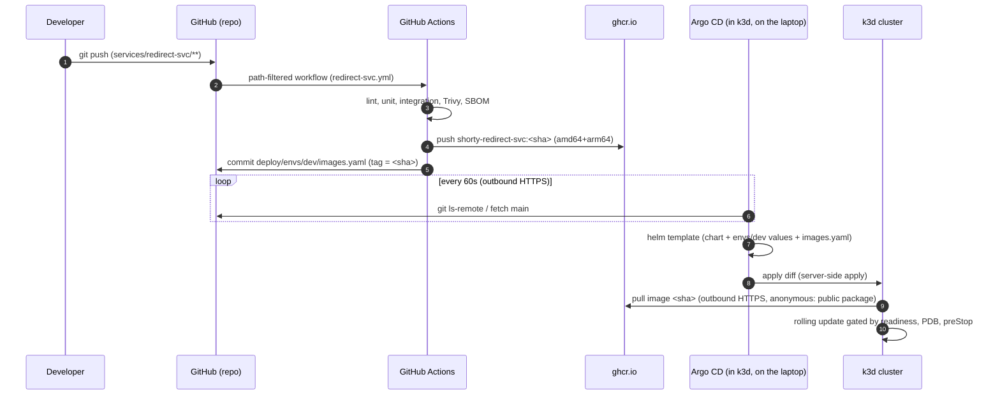

# GitOps: how a laptop cluster deploys from GitHub

Shorty uses **pull-based** continuous delivery. CI never holds cluster
credentials and never calls `kubectl` or `helm`; it only writes to Git and
GHCR. Argo CD, running *inside* the k3d cluster on the laptop, pulls both.



## Why nothing needs to reach the laptop

| Direction | Who connects | Protocol | Credentials |
|---|---|---|---|
| Argo CD repo-server → `github.com` | cluster → internet | HTTPS 443 | none (public repo) |
| containerd (k3s) → `ghcr.io` | cluster → internet | HTTPS 443 | none (packages inherit the public repo's visibility) |
| Argo CD → Helm repos (NATS, Traefik, CNPG) | cluster → internet | HTTPS 443 | none |
| GitHub Actions → laptop | **never** | – | – |

Every connection starts inside the cluster and goes outbound, so it works
behind home NAT, hotel Wi-Fi or a corporate proxy. There is no webhook
endpoint to expose and no tunnel to keep alive. The trade-off is latency:
Argo CD polls Git every **60s** (`timeout.reconciliation` in
`deploy/argocd/bootstrap/argocd-values.yaml`) instead of reacting to a push
webhook. To deploy right away, run `argocd app get shorty-dev --hard-refresh`
or click *Refresh* in the UI.

### If the repo or packages were private

1. **Git**: create a fine-grained PAT with `contents:read` on this repo only
   and register it with Argo CD:
   `argocd repo add https://github.com/<owner>/shorty.git --username x --password <PAT>`
   (it is stored as a labelled Secret in `argocd`).
2. **GHCR**: create a PAT with `read:packages`, then
   `kubectl create secret docker-registry ghcr -n shorty-dev --docker-server=ghcr.io --docker-username=<user> --docker-password=<PAT>`
   and set `imagePullSecrets` in the service charts (or patch the `default`
   ServiceAccount).
3. In real clusters, prefer GitHub App credentials (repo access) and External
   Secrets backed by a secret manager over long-lived PATs.

## Layout

```
deploy/argocd/
├── bootstrap/argocd-values.yaml   # Helm values for Argo CD itself (scripts/gitops.sh)
├── root.yaml                      # the ONLY object applied by hand: app-of-apps
└── apps/                          # everything else, reconciled from Git
    ├── project.yaml               # AppProjects: shorty (namespaced only) + platform
    ├── platform-traefik.yaml      # adopts the Helm release from scripts/platform.sh
    ├── platform-cnpg.yaml
    ├── shorty-dev.yaml            # automated: prune + selfHeal, tracks main
    └── shorty-ha.yaml             # manual sync
```

## Environments and promotion

| Env | Namespace | Host | Sync | Image tags come from |
|---|---|---|---|---|
| dev | `shorty-dev` | `dev.localhost:8088` | automatic (prune, self-heal) | `deploy/envs/dev/images.yaml`, bumped by CI on every green `main` build of that service |
| ha | `shorty-ha` | `ha.localhost:8088` | **manual** | `deploy/envs/ha/images.yaml`, pinned to the semver by `release.yml` when a `vX.Y.Z` tag is pushed |
| local | `shorty` | `localhost:8088` | none (`make deploy`, Helm) | locally built images in `127.0.0.1:5001` |

Promoting to `ha`:

```bash
git tag v0.2.0 && git push origin v0.2.0      # builds + pushes :0.2.0, pins envs/ha
argocd app sync shorty-ha                     # or "Sync" in the UI after reviewing the diff
```

Rolling back is a Git revert of the `chore(gitops): ...` commit, or
`argocd app rollback shorty-ha <history-id>` in an emergency. Self-heal on
`dev` undoes any manual `kubectl edit`, so Git always stays the source of
truth.

## Secrets

Database credentials are **not** in Git. `scripts/secrets.sh` creates them per
namespace (random 192-bit passwords), and the CNPG managed roles read the same
Secrets. See [ADR 0005](adr/0005-secrets-out-of-git.md) for the
production path (External Secrets Operator / Sealed Secrets).

## Argo CD Image Updater (optional)

The default flow is CI commits the tag (above): every deployed version is a
reviewable Git commit, and CI already knows the tag. Argo CD Image Updater
could instead watch GHCR and write back to Git. It saves a CI job but adds a
controller that needs registry and Git write credentials inside the cluster.
That is the opposite of keeping the laptop credential-free, so it is not
enabled.
